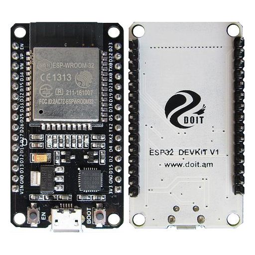
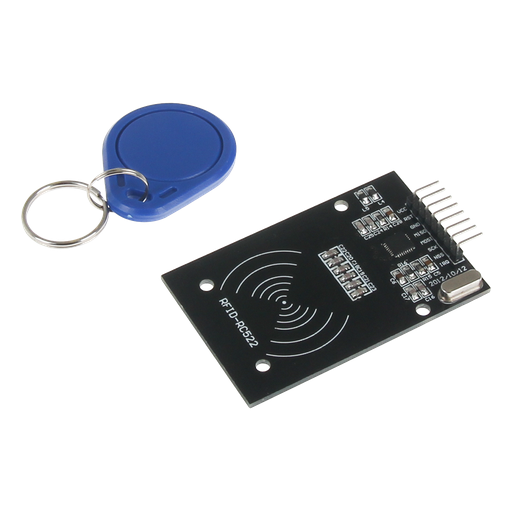
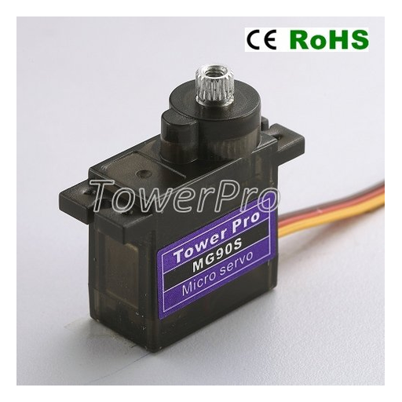
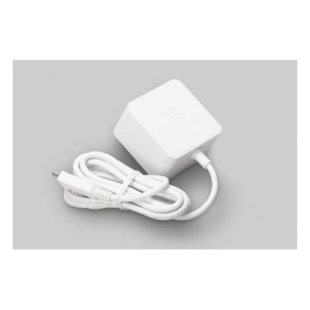
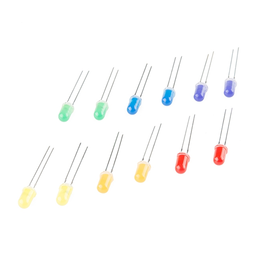
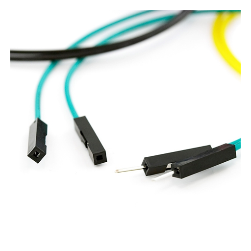
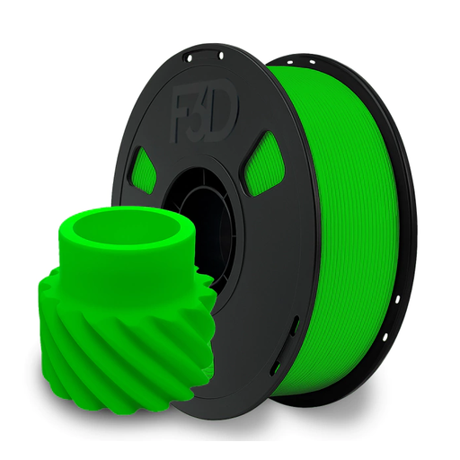

# Recursos e orçamento do Clack

Estimativa para **uma tranca e um cadastrador**, baseada nas quantidades informadas para o projeto e em preços anunciados no Brasil, consultados em **19/11/2026**. Os valores são médias aritméticas de anúncios, sem frete e sem descontos exclusivos por forma de pagamento. São uma referência de mercado, não o registro do que foi efetivamente pago.

**[Baixar a planilha editável com imagens, cálculos e cotações](./Orcamento_Clack.xlsx)**. Na planilha, altere os preços na aba “Cotações” ou as quantidades nas abas “Componentes” e “Materiais” para atualizar os cálculos.

## Componentes

| Imagem e referência | Componente | Tranca | Cadastrador | Preço médio por unidade |
|---|---|---:|---:|---:|
|  [Foto: Starting Electronics](https://startingelectronics.org/articles/ESP32-WROOM-testing/) | Placa ESP32 DevKit V1, ESP-WROOM-32, 30 pinos, micro-USB | 1 | 1 | R$ 52,40 |
|  [Foto: Joy-IT](https://joy-it.net/en/products/SBC-RFID-RC522) | Módulo leitor RFID MFRC522 / RC522, 13,56 MHz, SPI | 1 | 1 | R$ 15,77 |
|  [Foto: TowerPro](https://towerpro.com.tw/product/mg90s-3/) | Micro servo MG90S, engrenagens metálicas, 180° | 1 | — | R$ 21,60 |
|  [Foto: Raspberry Pi](https://www.raspberrypi.com/products/micro-usb-power-supply/) | Fonte bivolt 5 V / 2 A com conector micro-USB | 1 | 1 | R$ 29,93 |

As imagens representam modelos da mesma categoria: as marcas e os modelos exatos dos componentes físicos ainda devem ser confirmados. Em particular, a fonte fotografada é uma Raspberry Pi de **5,1 V / 2,5 A**, enquanto as fontes cotadas são genéricas de **5 V / 2 A**. Confirme o conector e teste a alimentação, inclusive durante o movimento do servo.

## Materiais de uso compartilhado

| Imagem e referência | Material | Referência de compra | Preço médio da referência | Custo unitário | Uso na tranca | Uso no cadastrador |
|---|---|---|---:|---:|---:|---:|
|  [Foto: SparkFun / Wikimedia Commons](https://commons.wikimedia.org/wiki/File:LED_Rainbow_Pack_-_5mm_PTH_12903-01.jpg) | LEDs difusos, 5 mm, vermelho, amarelo e verde | Pacote de 100 LEDs sortidos | R$ 14,68 | R$ 0,1468 por LED | 3 | — |
|  [Foto: SparkFun](https://www.sparkfun.com/jumper-wires-premium-6-m-f-pack-of-10.html) | Cabos jumper macho-fêmea, 20 cm | Pacote de 40 fios | R$ 10,44 | R$ 0,2610 por fio | 20 | 7 |
|  [Foto: F3D](https://www.filamentos3dbrasil.com.br/produtos/filamento-petg-verde/) | Filamento PETG F3D verde, 1,75 mm | Rolo de 1 kg | R$ 107,03 | R$ 0,1070 por grama | 93 g | Não informado |

- **Jumpers:** 20 por tranca, sendo 7 para o RFID, 10 para os LEDs e 3 para o servo. Para o cadastrador, foram considerados 7 fios para o RFID. O tipo de conector e o comprimento usados precisam de confirmação. O equivalente proporcional a 100 fios é R$ 26,10; isso não representa uma oferta verificada de pacote com 100.
- **Filamento:** dois chassis usam 186 g, ou 93 g por chassi. Um rolo de 1 kg rende teoricamente **10 chassis completos**, com 70 g restantes, sem considerar perdas ou outras peças. O equivalente a 100 g custa R$ 10,70. A média usa duas ofertas da F3D por canais diferentes, uma delas para verde-limão.
- **LEDs:** foram informados três LEDs sem resistores. Antes da instalação definitiva, avalie resistores limitadores de corrente adequados; eles não estão incluídos nesta estimativa. O diâmetro de 5 mm foi usado como referência de cotação e deve ser confirmado.

## Resumo por montagem

| Estimativa | Componentes | Materiais consumidos | Total |
|---|---:|---:|---:|
| Uma tranca | R$ 119,70 | R$ 15,61 | **R$ 135,31** |
| Um cadastrador | R$ 98,10 | R$ 1,83 | **R$ 99,93** |
| Conjunto | R$ 217,80 | R$ 17,44 | **R$ 235,24** |

O valor de materiais considera apenas as unidades utilizadas e os 93 g de PETG da tranca, sem acrescentar novamente o preço do rolo inteiro. Cartões e tags adquiridos separadamente, outras peças não confirmadas e frete **não estão incluídos**; portanto, este não é o custo total de todas as compras do projeto. O custo da embalagem inteira pode ser maior que o consumo atribuído a um conjunto.

## Fontes e uso das imagens

As imagens foram enquadradas em proporção 1:1 para a tabela. A imagem dos LEDs é de SparkFun Electronics, disponibilizada no Wikimedia Commons sob [CC BY 2.0](https://creativecommons.org/licenses/by/2.0/); ela foi redimensionada e enquadrada. As demais imagens são identificadas pelos links junto a cada peça; verifique as condições das fontes antes de reutilizá-las em outros materiais. Os endereços e valores de cada anúncio consultado estão na aba “Cotações” da planilha.
